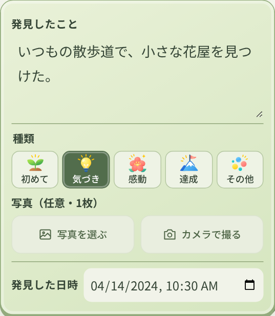
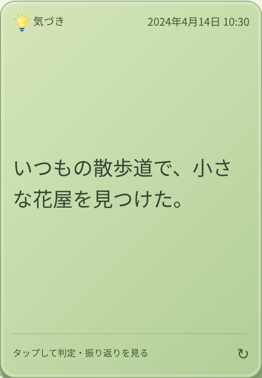
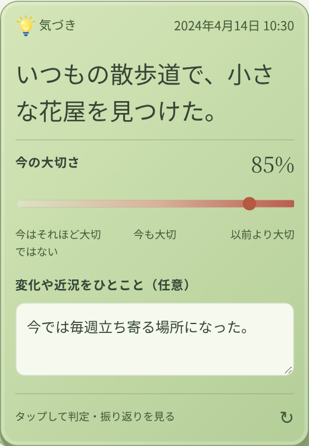

# Life Discovery

[](https://shimizukanta.github.io/Life_Discovery/)

今日の小さな発見を、1年後の自分へ。Life Discovery は、日々の気づきをカードに記録し、7日後と1年後に読み返せるアプリです。

## iPhoneのホーム画面に追加する

1. iPhoneのSafariで上の「アプリを開く」をタップします。
2. Safariの共有メニュー（四角から上向きの矢印）を開き、**「ホーム画面に追加」** を選びます。
3. **「追加」** をタップします。ホーム画面の「Life Discovery」アイコンを開くと、最初の発見を記録できます。

初回はオンラインで開いてください。アプリの「設定」に「オフラインで利用できます」と表示されたら、通信のない場所でも記録や振り返りができます。

## ひとつの発見を、1年かけて振り返る

1. **今日、記録する。** 「いつもの散歩道で、小さな花屋を見つけた。」と書いて、「気づき」を選びます。店先の花を残したければ、写真を1枚添えられます。
2. **7日後、残すか決める。** メニューの「1週間後の判定」でカードを読み返します。「また行きたい」と思ったら右にスワイプして「残す」。左でアーカイブ、迷ったら「あとで」を選べます。
3. **発見から1年後、今の気持ちを残す。** 「残す」を選んだカードが「1年後の振り返り」に現れます。スライダーで今の大切さを選び、「今では毎週立ち寄る場所になった。」と書き添えます。

| 発見を記録 | カードデッキ | 1年後の振り返り |
| --- | --- | --- |
|  |  |  |

## 過去の発見に出会う

- **種類で探す。** カードデッキでは「初めて」「気づき」「感動」「達成」「その他」を組み合わせて絞り込めます。カードをタップすると、裏面で判定や振り返りを読めます。
- **日付で探す。** カレンダーの年月をタップして、見たい年と月に移動します。日付を選ぶと、その日のカードが並びます。
- **偶然の1枚を開く。** デッキの「ランダムに出会う」をタップすると、絞り込み条件に合うカードがランダムに表示されます。

## 記録の保存と引っ越し

記録・写真・振り返りは、使っている端末のブラウザ内に保存されます。機種変更やブラウザのデータ消去の前に、「設定」から **「JSONを書き出す」** を選んでください。写真も含めて1つのファイルに保存できます。

新しい端末では **「JSONから復元」** でそのファイルを選びます。復元すると、移行先の記録と設定はバックアップの内容に置き換わります。Safariで書いた記録がホーム画面版に表示されない場合も、同じ手順で移せます。

## ローカルで開発する

Node.js 22以降を使用します。

```sh
npm ci
npm run dev
```

起動後、ブラウザで [ローカル版を開く](http://127.0.0.1:4173/) と動作を確認できます。`npm run build` で公開用ファイルを `dist/` に出力します。

型チェック、Lint、単体テスト、ブラウザーテストをまとめて実行するには、初回にChromiumをインストールします。

```sh
npx playwright install chromium
npm run check
```

GitHub Pagesへの公開手順は[実装ガイド](docs/implementation.md)にまとめています。
